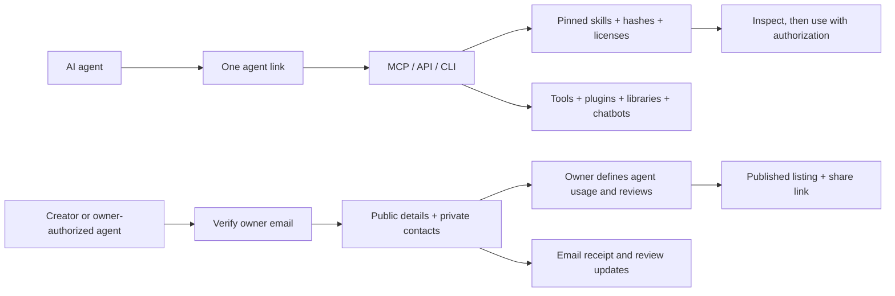

# SkillDash — the free Skill Library and AI directory

Give an AI agent this link: https://skills.maqamagent.com/agent.md

SkillDash is an agent-first software tool: **5,126 unique, licensed skill folders** from **17 repositories**, checked on October 12, 2026, plus **322 tool records**, including **315 individual plugins** recorded from the pinned official Claude plugin marketplace on October 13. Downloadable skill repositories require at least **10,000 repository stars** at the recorded check. Individual plugin repositories have their own metadata and requirements.



Machine manifest: https://skills.maqamagent.com/.well-known/agent.json


An open skill marketplace, npm CLI, and read-only MCP server for **Codex**, **Claude Code**, and **Delta Harness**.

SkillDash combines the curated Skill Library with a free community directory for **skills, AI products, plugins, libraries, MCP servers and tools**. Browse without an account. Verify your email to submit work and vote. Community submission has no minimum star count or listing fee.

**[Publish free](https://skills.maqamagent.com/publish)** · [Community directory](https://skills.maqamagent.com/products) · [Your account](https://skills.maqamagent.com/account) · [Publication policy](https://skills.maqamagent.com/publishing-policy)

Every approved community listing gets a public page and a **Listed on SkillDash** badge. A reviewer checks the public source, listing details and publication rights. This is not a security certification. Verified accounts get one reversible vote per listing; repository stars stay separate.

The existing curated downloadable catalog keeps its recorded source-selection policy, upstream licenses, pinned revisions and SHA-256 file checksums. Community submissions do not automatically become curated download archives.

## Accounts, reviews and notification delivery

Email sign-in uses a random one-time link expiring in 15 minutes. Only token hashes are stored. Production sessions use Secure, HttpOnly, SameSite cookies, expire after 14 days, and are revoked on sign-out. Account emails remain private.

Cloudflare Email Service sends sign-in links and submission notifications through the `EMAIL` binding. New submissions alert `contact@cognifyr.co`; approved listings notify their owner. Submission contacts are private and excluded from public APIs, MCP responses and published pages. The sender is restricted to `skilldash@cognifyr.co` on the already-onboarded company domain. No additional API key is needed.

D1 stores submissions and a transactional notification outbox. The five-minute scheduled worker retries failed notifications with backoff and removes expired authentication and rate-limit records. The reviewer account sees the pending queue and notification failures at `/review` after verifying the configured `ADMIN_EMAIL`. Review outcomes are persisted before mail is attempted.

Apply all D1 migrations before deploying. Version 0.4.0 adds `migrations/0003_agent_submissions.sql` for public agent usage details and private submission contacts. The migration adds account, session, listing, vote and notification tables; it preserves the original submission queue. Local account/voting/review tests use the same SQL schema in SQLite with mocked email delivery. Production email delivery requires the Cloudflare sender domain and binding.

**[Browse the library](https://skills.maqamagent.com)** · [Agent instructions](https://skills.maqamagent.com/llms.txt) · [API schema](https://skills.maqamagent.com/openapi.json)

Search thousands of real skill folders by name, description, and related task vocabulary. Preview instructions, bookmark skills, copy `SKILL.md`, or download the full ZIP with references and licenses.

[What are AI agent skills?](https://skills.maqamagent.com/guides/what-are-ai-agent-skills) ·
[Codex installation guide](https://skills.maqamagent.com/guides/codex-skills) ·
[Claude Code installation guide](https://skills.maqamagent.com/guides/claude-code-skills) ·
[Skill safety](https://skills.maqamagent.com/guides/skill-safety) ·
[Complete directory](https://skills.maqamagent.com/skills)

Every downloadable skill-catalog source is a public GitHub repository with **10,000+ repository stars** at the recorded check time. Stars belong to repositories, not individual skills. Source commits and file checksums are pinned. The catalog does not claim security certification or endorsement by source authors.

## Plugins and agent tools

[Browse plugins](https://skills.maqamagent.com/tools?type=plugin) or give an agent [the public instructions](https://skills.maqamagent.com/agent.md). The directory shows 20 records per page, with search/type filters and previous/next navigation. Every imported plugin records its upstream author where supplied, supported host, purpose, source revision, setup link and source ZIP. A repository ZIP can contain several plugins; inspect the linked plugin path before installing.

The official marketplace's stars describe that marketplace repository. They are not copied into each plugin's star count, and imported metadata is separate from reviewed community submissions. Individual plugin/service licenses, account requirements, pricing and permissions remain upstream requirements. A free listing does not make a paid connected service free.

Agents using the public HTTP MCP can call `search_tools` with `query`, `type`, `limit` and `offset`; responses include `total` and `nextOffset`. The equivalent HTTP endpoint uses `q`: `/api/tools?q=browser&type=plugin&limit=20&offset=20`. `scripts/sync-plugins.mjs` refreshes pinned official marketplace metadata without installing or executing plugins.

## Use from npm

Node.js 20.19 or newer:

```sh
npx agent-skill-library search "make a launch video"
npx agent-skill-library search "accessible React interfaces" --json
npx agent-skill-library show anthropics--skills--frontend-design --content
npx agent-skill-library install anthropics--skills--frontend-design --agent codex
```

Or install the CLI:

```sh
npm install -g agent-skill-library
skill-library search "test a website"
```

Use an exact ID from search results when several sources share a name. Name-only installation works when the name is unambiguous. Search is local and works offline; reading or installing a skill needs access to its pinned GitHub files.

## Teach your agent to use the library

```sh
npx agent-skill-library setup --agent all --global
```

This installs a small discovery skill in the three personal libraries. It does not install thousands of skills, alter model settings, or start an MCP process. Install only the skills relevant to your task.

| Target | Project installation | Personal installation |
| --- | --- | --- |
| Codex desktop / CLI | `.agents/skills/<name>` | `~/.agents/skills/<name>` |
| Claude Code | `.claude/skills/<name>` | `~/.claude/skills/<name>` |
| Delta Harness | Not applicable | Delta application-data directory, under `skills/<name>` |

Add `--global` for personal installation. Delta and `--agent all` require it. Use `--cwd <directory>` for another project. On Windows, Delta uses `%APPDATA%\Delta Harness\skills`; `DELTA_DATA_DIR` overrides the application profile. Codex detects skill changes automatically; restart if a new skill does not appear. Start a new Claude Code session or refresh Delta's Skills panel after installation.

For repository-based cloud tasks, commit the project skill folders. A personal install on your computer is not automatically available in a remote environment. Claude Code support does not imply that every Claude chat product automatically reads filesystem skills.

```sh
npx agent-skill-library install FULL-SKILL-ID --agent claude --global
npx agent-skill-library install FULL-SKILL-ID --agent delta --global
npx agent-skill-library install FULL-SKILL-ID --agent codex --dry-run
npx agent-skill-library list --agent codex --global --json
```

The installer downloads to a staging directory, checks every SHA-256, and then places the complete folder in the destination. Supporting scripts are never executed. Script executable bits are preserved. Linked installation paths, traversal, ambiguous Windows names, and unexpected download hosts are rejected.

Unmanaged skills are never overwritten. An existing managed revision needs `--force` to replace; local edits are protected by default, and extra local files block replacement even with `--force`. Back up your edits before requesting replacement.

## MCP

Connect the public SkillDash MCP once for every project on this computer:

```sh
npx agent-skill-library connect --host all --global
```

The connector merges a read-only HTTP server into the personal configurations for Codex, Claude Code, Cursor and Antigravity. It preserves other servers and settings, backs up changed files beside their original, refuses disabled or conflicting entries, and can be previewed with `--dry-run`. Refresh or restart your host after setup. No API key or local server process is required.

Endpoint: **https://skills.maqamagent.com/mcp**. Tools: `get_library_info`, `search_skills`, `read_skill`, `plan_skill_install`, `search_tools`, and `search_listings`. Skills retain source revisions, SHA-256 checksums, supporting resources and licenses. `search_tools` returns source-pinned upstream tool/plugin metadata; `search_listings` returns only published, reviewed community submissions. A listing review is not a security certification.

For a repository-based cloud workspace, run the command without `--global` and commit the four generated client configurations. Host trust or approval steps still apply. A remote machine has its own settings; a personal install on your laptop is not copied to it automatically. Hosted chat products require their own MCP connector configuration.

```sh
npx agent-skill-library connect --host all --cwd /path/to/project
npx agent-skill-library connect --host claude,cursor --global --dry-run --json
npx agent-skill-library doctor --host all --global --json
```

The global paths are `~/.codex/config.toml`, `~/.claude.json`, `~/.cursor/mcp.json` and `~/.gemini/config/mcp_config.json`. Project paths are `.codex/config.toml`, `.mcp.json`, `.cursor/mcp.json` and `.agents/mcp_config.json`. Antigravity remote entries use `serverUrl`; Claude Code entries use `type: "http"` and `url`.

If an older Antigravity IDE profile already has `~/.gemini/antigravity/mcp_config.json`, global setup also merges the connector there. The legacy profile is never created on a new installation.

SkillDash provides public discovery context. Qarinah keeps opted-in project memory locally. Connecting SkillDash does not upload project history or grant access to private computer files.

### Local stdio alternative

```json
{
  "mcpServers": {
    "skill-library": {
      "command": "npx",
      "args": ["-y", "agent-skill-library", "mcp"]
    }
  }
}
```

The stdio server provides the same six tool names. Skill search and tool metadata use the packaged snapshot; community listing search needs the public website. The published 0.4.0 npm snapshot predates this new plugin import and pagination. Use the public HTTP MCP for the current marketplace catalog; the global connector above uses that endpoint. It inspects and plans; it does not execute downloaded instructions or write installations. Configure the command in your client's MCP settings. No service API key is required.

## Public API and submissions

```sh
curl "https://skills.maqamagent.com/api/skills?q=video&limit=10"
curl "https://skills.maqamagent.com/api/categories"
```

Skill routes: `/api/skills/{id}`, `/content`, `/manifest`, and `/download`. Direct assets are available at `/documents/{id}.md`, `/manifests/{id}.json`, and `/bundles/{id}.zip`.

```sh
npx agent-skill-library submit https://github.com/OWNER/REPO --path skills/NAME
```

The CLI prepares a prefilled owner-verification form. The website or an owner-authorized API client submits public details after verifying the owner email. A submission receipt and review outcomes go to that email. Phone is optional, private and unverified. The reviewer defines agent compatibility and usage before approving publication. The curated download collector separately checks the 10,000-star source policy, licenses, portable frontmatter, pinned revisions and complete supporting files. The legacy anonymous /api/submissions endpoint returns 410 with the new form and schema.

Maintainers can inspect the queue with `npx wrangler d1 execute agent-skill-library --remote --command "SELECT id, repo, skill_path, status FROM submissions WHERE status = 'pending'"`, review the source, and add its approved prefix to `registry/sources.json`. Running `npm run sync` produces a reviewable catalog diff; commit and deploy only after checks pass.

## Develop and reproduce

```sh
npm ci
npm run check
npm test
npm run hydrate
npm run build
npm run check:seo
npm run preview
```

`hydrate` reproduces the exact ZIPs from the committed manifests, rechecking hashes. It may download the pinned upstream repository archives on a clean checkout. It does not update the catalog. `sync` intentionally refreshes stars and source revisions, deduplicates exact instruction content, and regenerates manifests and assets. GitHub authentication through `gh auth login` or `GH_TOKEN` avoids low anonymous API limits.

```sh
npm run sync
npm run check
npm test
npm run build
npm run test:browser
```

Deployment uses Cloudflare Workers static assets plus a small search/submission Worker and D1. Review `wrangler.jsonc` and create your own D1 database/custom domain before deploying a fork:

```sh
npx wrangler d1 migrations apply agent-skill-library --local
npx wrangler dev
# For this configured production project:
npx wrangler d1 migrations apply agent-skill-library --remote
npm run deploy
```

Frontend-only development is available through `npm run dev:web`; full API and submission behavior uses Wrangler.

The production build renders complete HTML skill pages, category hubs, a paginated
directory and installation guides. They remain readable without JavaScript.
Per-page titles, canonical URLs, social previews, structured data and XML sitemaps
are generated from the same source catalog. See [search discovery](docs/SEARCH-DISCOVERY.md)
for the research basis, checks and indexing procedure.

For copy feedback and discovery-page browser checks, run Wrangler on port 8797
and run `npm run test:copy-seo`. Set `LIBRARY_TEST_URL` to test another local or
deployed URL. These checks cover actual clipboard writes, permission denial,
repeated clicks, changed commands, reduced motion, mobile layout and reading
pages without JavaScript.

## Provenance and compatibility

See [THIRD-PARTY.md](THIRD-PARTY.md), [the source configuration](registry/sources.json), and [the sync report](registry/sync-summary.json). The library code is MIT; upstream skills retain their own licenses. The generic SKILL.md format travels between clients, but specialized skills may still require their own runtimes, tools, credentials, or subscriptions.

The locally distributed Brag skill is not republished here: its public upstream and bundled audio redistribution rights were not established. Search for “brag” or “launch video” to discover the licensed Hyperframes video workflows. Delta can also discover a user's existing local Brag installation.

## Contribute and report security issues

See [CONTRIBUTING.md](CONTRIBUTING.md) for source submissions and development,
[the branch policy](.github/REPOSITORY-SECURITY.md) for protected pull/push workflows,
and [SECURITY.md](SECURITY.md) for private vulnerability reports.
